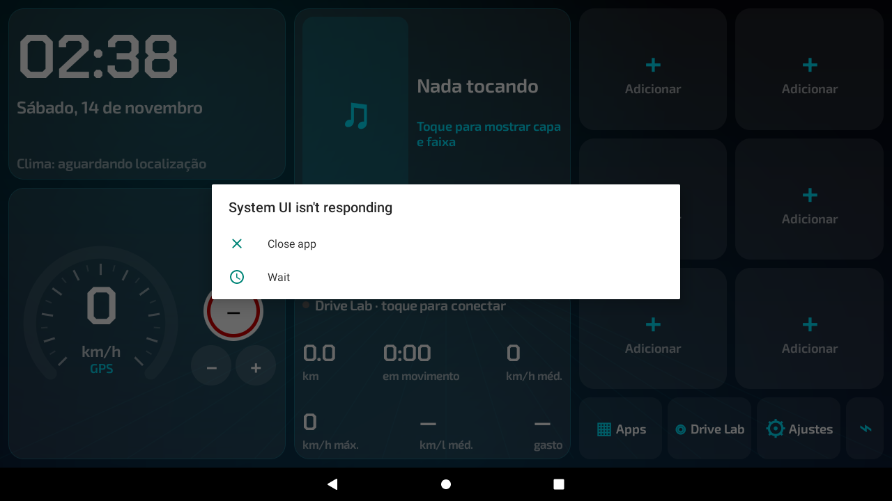
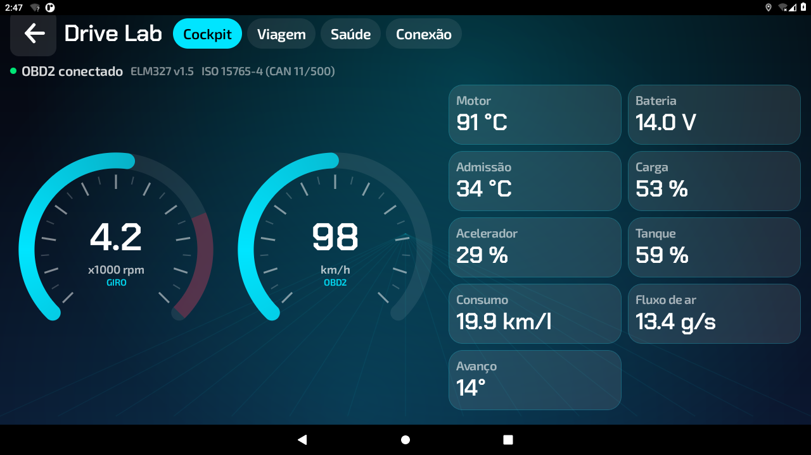
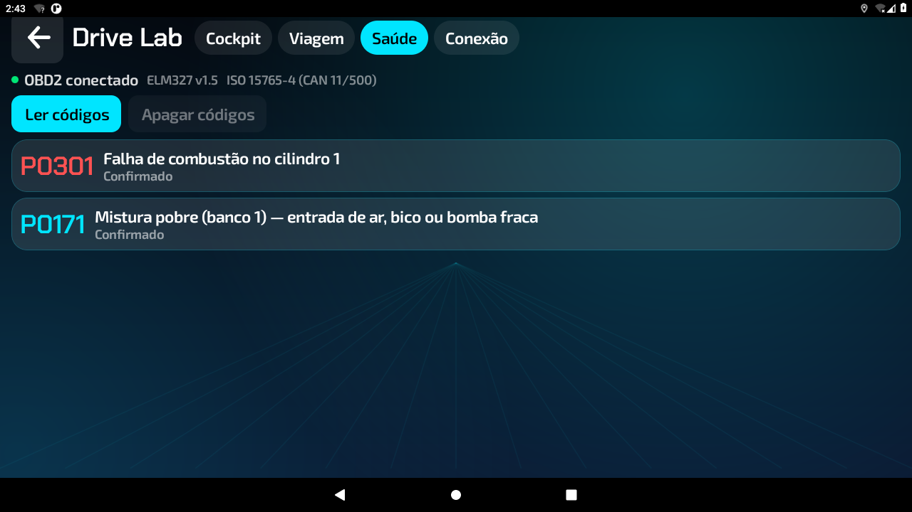

# Cockpit Launcher

Launcher (tela inicial) para central multimídia Android, feito do zero, **grátis e sem licença**.
Inspirado no tipo de recurso que o Rota Launcher oferece, mas com código próprio.

APK pronto: [`dist/cockpit-launcher-1.0.0.apk`](dist/cockpit-launcher-1.0.0.apk)

## Instalar na central

1. Copie o `.apk` para um pendrive (ou baixe direto na central).
2. Abra o arquivo pelo gerenciador de arquivos da central. Se aparecer um bloqueio, autorize "instalar apps desconhecidos".
3. Abra o **Cockpit**, aceite a localização e, em **Ajustes → Definir como tela inicial**, escolha o Cockpit.
4. Para mostrar capa e nome da música: **Ajustes → Liberar capa e faixa da música**.
   No Android 13 ou superior: Informações do app → ⋮ → "Permitir configurações restritas" e tente de novo.
5. OBD2: **Drive Lab → Conexão**. Escolha Bluetooth, BLE ou Wi-Fi. Use **Demonstração** para conhecer sem adaptador.

Requisitos: Android 7.0 ou superior. Funciona em tela horizontal e vertical.

## Recursos

| Recurso | Cockpit |
|---|---|
| Tela inicial, atalhos (6 botões, toque e segure para trocar), gaveta de apps com busca | ✅ |
| Velocímetro por GPS ou OBD2, placa de limite e aviso sonoro | ✅ |
| Música: capa, faixa, progresso, controles e volume (funciona sem permissão pelas teclas de mídia) | ✅ |
| Clima com máx./mín. e chance de chuva (Open-Meteo, sem chave) | ✅ |
| Brilho automático no nascer e no pôr do sol | ✅ |
| Entrada de boas-vindas com o seu nome e varredura do velocímetro | ✅ |
| 12 cores prontas + cor livre, 7 fundos, foto de fundo, fundo em movimento, 3 estilos de botão | ✅ |
| Tema por código (passe sua tela para um amigo) | ✅ |
| Drive Lab OBD2: giro, velocidade, motor, admissão, bateria, carga, acelerador, tanque, avanço, fluxo de ar | ✅ |
| Consumo instantâneo (km/l ou L/h) e por viagem, litros e custo em R$ (gasolina, etanol ou diesel) | ✅ |
| Códigos de falha confirmados **e pendentes**, explicados em português, e apagar códigos | ✅ |
| ELM327 Bluetooth clássico, **BLE** e Wi-Fi, com reconexão automática | ✅ |
| Console para comandos AT/PID | ✅ |
| Modo demonstração do OBD2 | ✅ |
| Bloqueio dos ajustes com o carro em movimento | ✅ |
| Sem licença, sem marca d'água, sem anúncios, sem coleta de dados | ✅ |

## Compilar

```bash
echo "sdk.dir=/caminho/do/android-sdk" > local.properties
./gradlew assembleRelease
# app/build/outputs/apk/release/app-release.apk
```

A chave de assinatura fica em `keystore/` (senha `cockpit123`). Mantenha a mesma chave para conseguir
instalar atualizações por cima sem perder as configurações.

## Análise do Rota Launcher 0.13.7 (base da comparação)

- Pacote `br.com.rotalauncher`, versionCode 24, minSdk 24 (Android 7), targetSdk 34.
- Kotlin + Jetpack Compose (Material 3), compilado com R8 (código ofuscado). APK de 5,6 MB, quase tudo imagens.
- Componentes: `MainActivity` (categoria HOME), `TripService` (serviço de localização em primeiro plano),
  `MediaListenerService` (acesso às sessões de mídia), `BootReceiver`.
- Permissões: localização, Bluetooth/BLE, internet, `QUERY_ALL_PACKAGES`, `WRITE_SETTINGS` (brilho),
  leitura de imagens, serviço em primeiro plano e início no boot.
- Licença validada online em `rota-vendas.rotalauncher.workers.dev` (`/ativar` e `/licenca`), uma chave
  por aparelho; reembolso cancela a chave na próxima conexão.
- Pacotes de carros baixados à parte (`/pacotes/minha-garagem.zip`, `/pacotes/marcas.zip`).
- Clima pela API do MET Norway; OBD2 com ELM327 (Bluetooth clássico, BLE e Wi-Fi).
- Versão grátis limita temas, "Minha Garagem", Drive Lab (só demonstração) e mostra marca na tela;
  completa custa R$ 49,90.

O Cockpit **não usa nenhum código, imagem ou recurso** do Rota Launcher; é uma implementação independente.
A "Minha Garagem" (200+ carros desenhados) não foi copiada: as imagens são do autor do Rota Launcher.
No Cockpit você pode usar a foto do seu próprio carro como fundo.

## Telas (emulador 1280×720)




