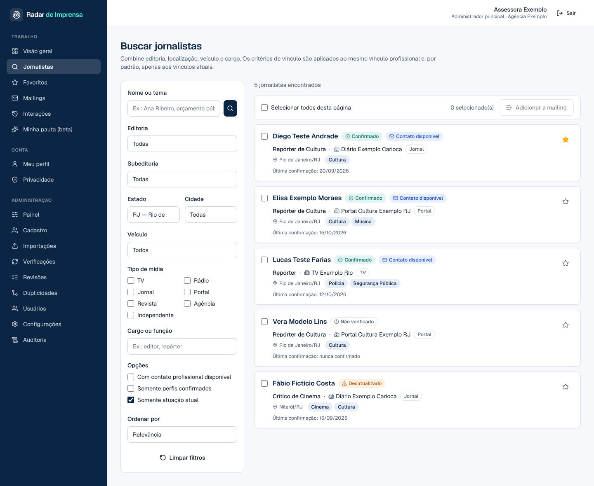

# Radar de Imprensa

Plataforma brasileira de inteligência de imprensa: conecta assessores de comunicação aos jornalistas mais relevantes para cada
pauta, com dados profissionais verificáveis, histórico de vínculos preservado e controle de atualização dos registros.

> Todos os dados de exemplo deste repositório (seed, CSV, capturas) são **fictícios**, com domínios reservados `.example`.



## O que está implementado

| Área | Situação |
| --- | --- |
| Autenticação (cadastro, login, confirmação de e-mail, logout) com Supabase Auth | ✅ |
| Quatro papéis (assessor, jornalista, administrador, administrador principal) com RLS e checagem no servidor | ✅ |
| Busca avançada `/jornalistas` (editoria/subeditoria, UF, cidade, veículo, tipo de mídia, cargo, contato, verificados, atuação atual), paginação, ordenação, filtros na URL | ✅ |
| Perfil `/jornalistas/[id]` com vínculos atuais e históricos, fontes, datas separadas (confirmação/evidência/busca), contatos sob demanda | ✅ |
| Favoritos, mailings (privados ou da organização), notas, exportação CSV autorizada, interações | ✅ |
| Jornalista: reivindicação de perfil, autogestão (contatos, canal preferencial, vínculos, temas), confirmação dos dados | ✅ |
| Privacidade/LGPD: política, bases legais, solicitações (acesso, correção, ocultação, exclusão, oposição) e atendimento | ✅ |
| Administração: painel, cadastro manual, importação CSV com prévia/deduplicação/aprovação, revisões, duplicidades (unificar/separar), usuários, configurações, auditoria | ✅ |
| Verificação periódica (~30 dias, lotes pequenos, evidências, propostas, nova tentativa, reprocessamento) | ✅ com provedor demonstrativo; adaptador Brave implementado mas **não testado com chave real** |
| "Encontrar jornalistas para minha pauta" (fase 2) | Arquitetura pronta, interpretação por regras; **desligado por feature flag** |

Detalhes em [docs/ARQUITETURA.md](docs/ARQUITETURA.md), [docs/LIMITACOES.md](docs/LIMITACOES.md) e [docs/ROADMAP.md](docs/ROADMAP.md).

## Stack

Next.js 16 (App Router) · TypeScript strict · Tailwind CSS 4 · componentes no padrão shadcn/ui · Supabase (PostgreSQL, Auth, RLS,
Cron, Edge Functions) · Zod · React Hook Form · Vitest · Playwright.

## Instalação local

Pré-requisitos: Node.js 20.9+ e um projeto Supabase (nuvem, plano gratuito) **ou** o Supabase CLI com Docker.

```bash
cd radar-imprensa
npm install
cp .env.example .env.local      # preencha as variáveis
```

### Opção A — Supabase local (CLI + Docker)

```bash
npx supabase start               # sobe Postgres, Auth, REST e Studio
npx supabase db reset            # aplica supabase/migrations e supabase/seed.sql (dados fictícios)
# copie "API URL" e "anon key" exibidos para .env.local
npm run dev                      # http://localhost:3000
```

### Opção B — Supabase na nuvem

1. Crie o projeto em supabase.com.
2. `npx supabase link --project-ref SEU_REF` e `npx supabase db push` (aplica as migrations).
3. Opcional, apenas em ambiente de desenvolvimento: rode `supabase/seed.sql` no SQL Editor.
4. Preencha `NEXT_PUBLIC_SUPABASE_URL` e `NEXT_PUBLIC_SUPABASE_ANON_KEY` e rode `npm run dev`.

### Primeiro administrador

Cadastre-se pelo app e execute [`scripts/promote-admin.sql`](scripts/promote-admin.sql) com o seu e-mail. Os demais papéis são
concedidos em `/admin/usuarios`. O cadastro público nunca cria administradores.

Sem as variáveis do Supabase o app não quebra: as páginas públicas funcionam e as áreas autenticadas mostram
`/configuracao-necessaria`.

## Scripts

| Comando | O que faz |
| --- | --- |
| `npm run dev` / `build` / `start` | Desenvolvimento, build e produção |
| `npm run lint` / `typecheck` | ESLint e TypeScript |
| `npm test` | Testes unitários (domínio puro) |
| `npm run test:db` | Testes de banco: recria `radar_imprensa_test` (shim do Supabase + migrations + seed) num PostgreSQL real e testa RLS, RPCs e fluxos |
| `npm run test:e2e` | E2E com Playwright contra o app em produção + PostgREST + gateway de Auth de teste (ver [docs/TESTES.md](docs/TESTES.md)) |
| `npm run check` | lint + typecheck + unitários |

## Documentação

- [Arquitetura](docs/ARQUITETURA.md) — camadas, banco, segurança, verificação, identidade
- [Deploy (Supabase + Vercel + Cron)](docs/DEPLOY.md)
- [Privacidade e LGPD](docs/LGPD.md)
- [Testes](docs/TESTES.md)
- [Limitações conhecidas](docs/LIMITACOES.md)
- [Funcionalidades futuras](docs/ROADMAP.md)
